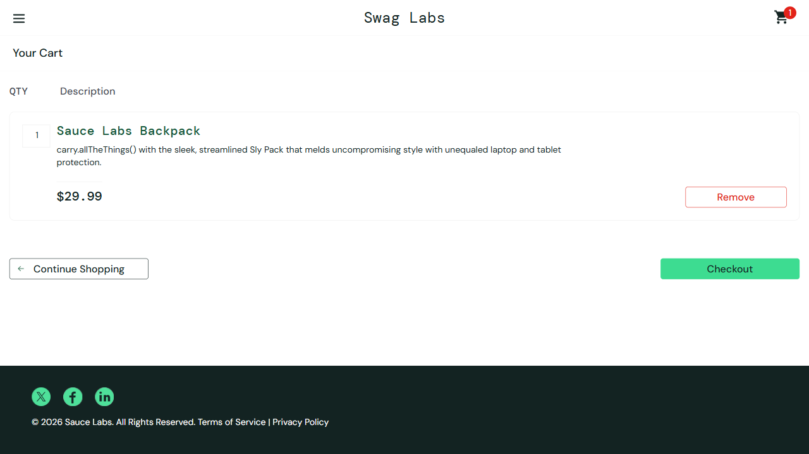
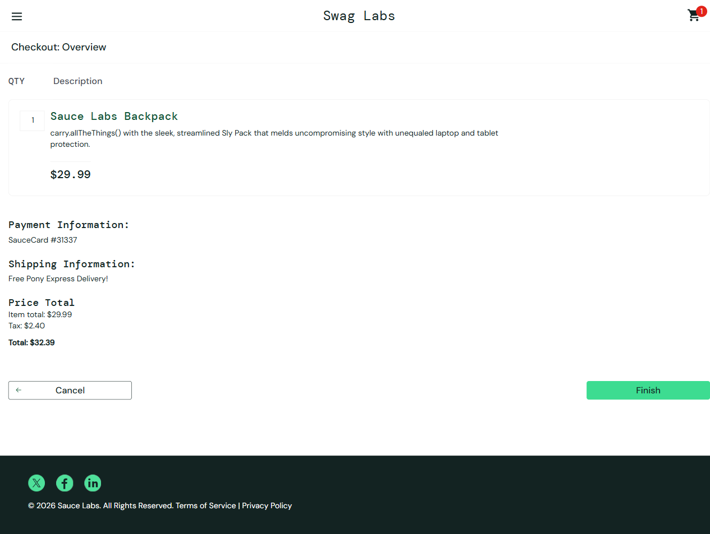
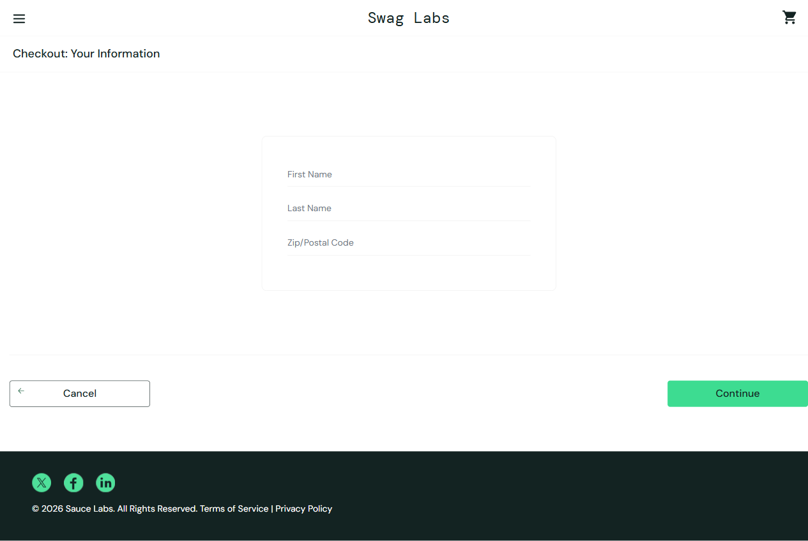
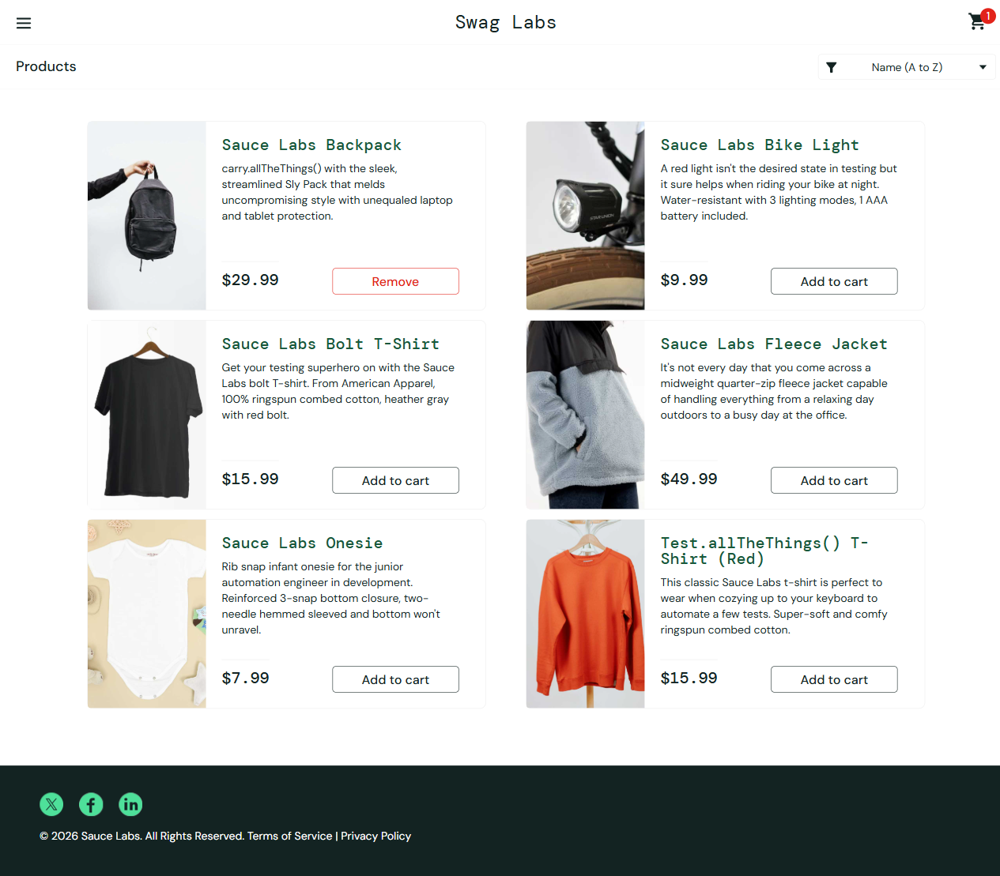
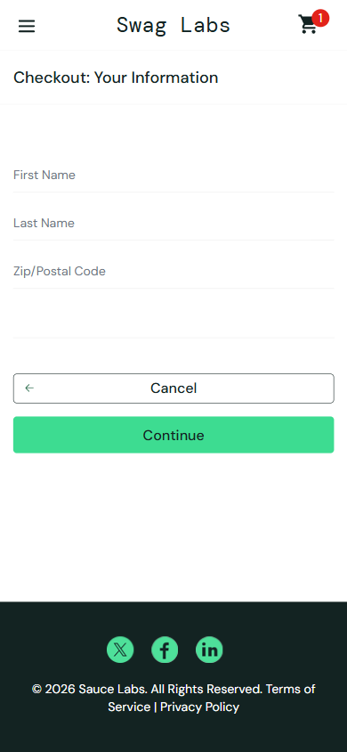

# SCRUM-101 Checkout Test Execution Report

**Application:** [SauceDemo](https://www.saucedemo.com)
**Execution date:** 2026-10-28
**Environment:** Windows, Playwright 1.64.1; Chromium, Firefox, and WebKit
**Test account:** `standard_user` (demo account)

## 1. Executive Summary

- **Planned scenarios:** 11
- **Manual scenarios executed:** 11 (8 pass, 3 fail)
- **Automated executions:** 33 (11 scenarios across 3 browser projects)
- **Final automated results:** 24 pass, 9 fail
- **Distinct automated scenarios:** 8 pass, 3 fail
- **Overall status:** **FAIL** — three application behaviors violate the stated requirements and reproduced in all configured browsers.

The initial automation run had 10 failures caused by test locators using Playwright's default `data-testid` attribute while SauceDemo uses `data-test`. The Playwright configuration was corrected to set `testIdAttribute: 'data-test'`; a focused cart test then passed. This harness issue is resolved and is not included in the final defect count.

## 2. Manual Test Results

| ID | Scenario | Result | Observation |
|---|---|---|---|
| T01 | Cart review displays product details and checkout actions | PASS | Backpack name, description, $29.99 price, quantity 1, Continue Shopping, and Checkout were present. |
| T02 | Checkout information requires each mandatory field | PASS | Empty form reported First Name; partial submissions reported Last Name and Postal Code as required. |
| T03 | Checkout rejects invalid name and postal data | FAIL | Special-character-only values (`!@#`, `$%^`, `???`) were accepted and advanced to the order overview. |
| T04 | Cancel from checkout information returns to the cart | PASS | Cancel returned to Cart with the Backpack still present. |
| T05 | Cancel from order overview returns to the cart | FAIL | Cancel returned to Products (`inventory.html`), not Cart; the cart badge still showed one item. |
| T06 | Order overview shows payment, shipping, items, and totals | PASS | Backpack, SauceCard #31337, Free Pony Express Delivery!, $29.99 subtotal, $2.40 tax, and $32.39 total were shown. |
| T07 | Finishing an order confirms purchase, clears cart, and allows return home | PASS | Confirmation message and Back Home action appeared; the cart was empty after completion. |
| T08 | Empty cart cannot proceed to checkout | FAIL | Checkout was enabled and navigated to the checkout information page despite an empty cart. |
| T09 | Unauthenticated user cannot open checkout directly | PASS | Direct navigation to checkout redirected to the login page. |
| T10 | Checkout remains usable at a mobile viewport | PASS | At 390×844, checkout fields and controls were visible; checkout information and overview had no horizontal overflow. |
| T11 | Browser Back from overview returns to checkout information | PASS | Browser Back returned to checkout information with the cart preserved. Entered form values were cleared. |

### Screenshot Evidence

**Cart review**

**Invalid data advanced to order overview**

**Empty cart can reach checkout information**

**Cancel from overview returns to Products**

**Mobile checkout information**

## 3. Automated Test Results

### Initial Run and Healing

| Run | Result | Analysis / action |
|---|---:|---|
| Initial Chromium run | 1 passed, 10 failed | Login locators timed out because the test ID attribute did not match SauceDemo's `data-test`. |
| Locator/config healing | Focused cart test passed | Set `testIdAttribute: 'data-test'` in Playwright configuration. This corrected the automation harness. |
| Final cross-browser run | 24 passed, 9 failed | Each of the three product defects failed once per browser; all other scenarios passed in all three browsers. |

MCP `test_debug` was used to inspect the invalid-data and overview-cancel failures. Both reached the pages the application actually serves, confirming acceptance failures rather than locator or timing issues. The custom healer agent could not be launched because its local definition specifies a model unavailable in this environment. No product-defect assertions were skipped or relaxed.

### Final Results by Test Suite

| Test suite | Chromium | Firefox | WebKit | Total |
|---|---:|---:|---:|---:|
| Browser Back navigation | 1 pass | 1 pass | 1 pass | 3 pass |
| Checkout cancellation | 1 pass, 1 fail | 1 pass, 1 fail | 1 pass, 1 fail | 3 pass, 3 fail |
| Cart review | 1 pass | 1 pass | 1 pass | 3 pass |
| Checkout access control | 1 pass | 1 pass | 1 pass | 3 pass |
| Checkout validation | 1 pass, 1 fail | 1 pass, 1 fail | 1 pass, 1 fail | 3 pass, 3 fail |
| Empty-cart protection | 1 fail | 1 fail | 1 fail | 3 fail |
| Mobile checkout | 1 pass | 1 pass | 1 pass | 3 pass |
| Order completion | 1 pass | 1 pass | 1 pass | 3 pass |
| Order overview | 1 pass | 1 pass | 1 pass | 3 pass |
| **Totals** | **8 pass, 3 fail** | **8 pass, 3 fail** | **8 pass, 3 fail** | **24 pass, 9 fail** |

## 4. Defects Log

### SCRUM-101-D01 — Invalid checkout data is accepted

- **Severity:** Medium
- **Description:** Checkout accepts special-character-only first name, last name, and postal code values, then navigates to order overview without a validation message.
- **Steps to reproduce:** Log in, add a product, open Checkout; enter `!@#`, `$%^`, and `???` in First Name, Last Name, and Zip/Postal Code; select Continue.
- **Expected:** Invalid values are rejected and the user remains on checkout information with an appropriate validation error.
- **Actual:** The page advances to `checkout-step-two.html`.
- **Evidence:** [Invalid-data screenshot](./evidence/invalid-data-advanced-to-overview.png)
- **Environment:** SauceDemo, Playwright 1.64.1; reproduced in Chromium, Firefox, and WebKit.

### SCRUM-101-D02 — Empty cart can proceed to checkout

- **Severity:** Medium
- **Description:** The Checkout button remains enabled for an empty cart and the user can navigate to checkout information.
- **Steps to reproduce:** Log in without adding products, open the cart, and select Checkout.
- **Expected:** Checkout is disabled, absent, or prevented from advancing while the cart is empty.
- **Actual:** The empty cart page has an enabled Checkout button and routes to `checkout-step-one.html`.
- **Evidence:** [Empty-cart checkout screenshot](./evidence/empty-cart-checkout-page.png)
- **Environment:** SauceDemo, Playwright 1.64.1; reproduced in Chromium, Firefox, and WebKit.

### SCRUM-101-D03 — Cancel from order overview returns to Products

- **Severity:** Low
- **Description:** Cancel on the order overview navigates to Products rather than returning to the cart as required by the business rule. The item remains in the cart.
- **Steps to reproduce:** Add the Backpack, start checkout, enter valid customer details, continue to overview, and select Cancel.
- **Expected:** The cart page is shown with the Backpack preserved.
- **Actual:** The products page (`inventory.html`) is shown with the Backpack still in the cart.
- **Evidence:** [Overview-cancel screenshot](./evidence/overview-cancel-returns-to-products.png)
- **Environment:** SauceDemo, Playwright 1.64.1; reproduced in Chromium, Firefox, and WebKit.

## 5. Test Coverage Analysis

| Acceptance criterion / rule | Manual coverage | Automated coverage | Status |
|---|---|---|---|
| AC1 — Cart item details, quantity, price, and checkout actions | T01 | Cart review | Pass for listed item details/actions. Cart page itself does not show a cart total; totals are shown in overview. |
| AC2 — Checkout fields are mandatory and identify missing values | T02 | Required-field validation | Pass |
| AC3 — Overview item, payment, shipping, totals, Cancel/Finish | T05, T06 | Overview and cancellation | Overview passes; overview Cancel destination fails. |
| AC4 — Confirmation, success message, Back Home | T07 | Order completion | Pass |
| AC5 — Invalid data is rejected | T03 | Invalid-data validation | Fail (D01) |
| Business rule — login required | T09 | Checkout access control | Pass |
| Business rule — cart cannot be empty at checkout | T08 | Empty-cart protection | Fail (D02) |
| Business rule — completed order clears cart | T07 | Order completion | Pass |
| Business rule — cancel returns to cart | T04, T05 | Checkout cancellation | Information Cancel passes; overview Cancel fails (D03). |
| Mobile responsiveness and browser Back | T10, T11 | Mobile and browser navigation | Pass at tested 390×844 viewport; Back clears entered form values. |

The suite covers all five acceptance criteria and the specified login, empty-cart, cart-clearing, cancel, mobile, and back-navigation rules. Coverage is focused on one product (Sauce Labs Backpack) and a 390×844 mobile viewport; additional multi-item totals, postal-code boundary formats, and a broader device-size matrix remain useful follow-up coverage.

## 6. Summary and Recommendations

The normal cart, required-field, overview, order-completion, login-protection, mobile, and browser-back flows behaved as expected. Three requirement-level defects were consistent across all tested browser engines and should be addressed before accepting SCRUM-101:

1. Validate checkout names and postal data before advancing.
2. Prevent checkout when the cart is empty.
3. Make Cancel from the order overview return to Cart.

The automation harness now uses SauceDemo's `data-test` attributes and the complete 11-scenario suite is runnable with `npm run test:checkout`. The final suite intentionally remains red for the three observed product defects; rerun it after the application fixes.
